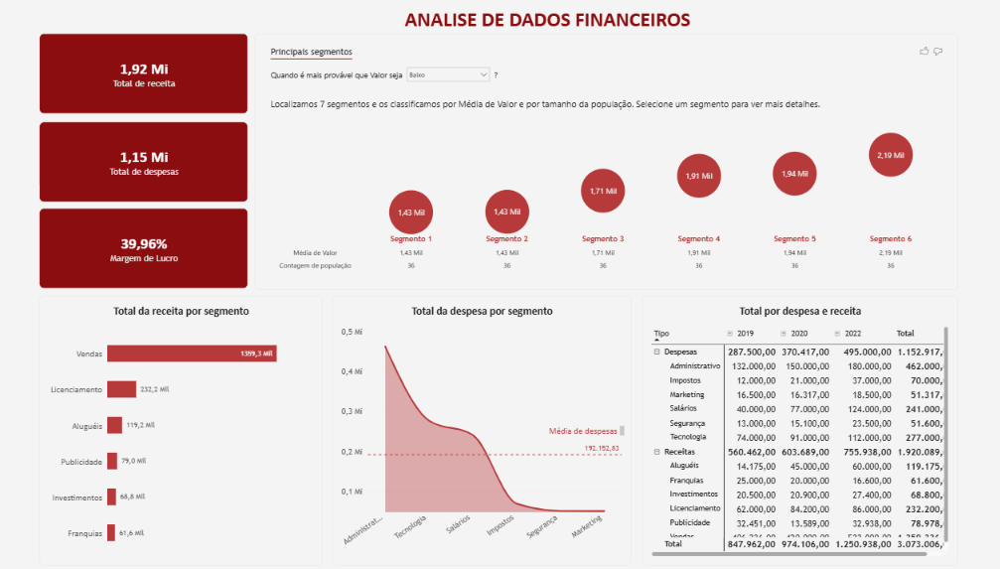

# Análise de Dados Financeiros com Power BI

## Sobre o Projeto
Neste projeto foi desenvolvido um dashboard financeiro utilizando o Power BI, com o objetivo de analisar receitas, despesas e indicadores financeiros de uma empresa fictícia.
O projeto foi desenvolvido como parte de um mini projeto de estudos da Data Science Academy (DSA), com foco na exploração de funcionalidades do Power BI aplicadas à análise financeira e ao apoio à tomada de decisões.

## Objetivos
- Analisar o total de receitas e despesas da empresa.
- Acompanhar a margem de lucro.
- Comparar receitas por componente.
- Analisar despesas por componente em relação à média de despesas.
- Comparar receitas e despesas por componente e por ano.
- Identificar segmentos relevantes para apoiar o planejamento estratégico.

## Ferramenta Utilizada
Power BI Desktop para desenvolvimento do dashboard e visualização dos dados.

## Dashboard
O dashboard consolida os principais indicadores financeiros em uma única página, permitindo visualizar e comparar os resultados de forma prática e intuitiva.

## Aprendizados
Durante o desenvolvimento deste projeto, foram explorados conceitos e recursos de:
- Construção de dashboards financeiros no Power BI.
- Organização e visualização de indicadores.
- Comparação de receitas e despesas por categoria.
- Análise de despesas em relação à média.
- Exploração de dados por ano, tipo e componente.
- Comunicação visual de informações para apoiar decisões de negócio.

## Fonte dos Dados
Projeto de estudo baseado em um mini projeto da DSA. A atividade utiliza uma base de dados fictícia para explorar recursos de análise financeira no Power BI.
**Os dados são utilizados para fins educacionais.**

## Sobre o Projeto
Este projeto faz parte do meu desenvolvimento de habilidades em Análise de Dados e Business Intelligence, com foco na utilização do Power BI para transformar dados em informações visuais que apoiem a análise de resultados e a tomada de decisões.

